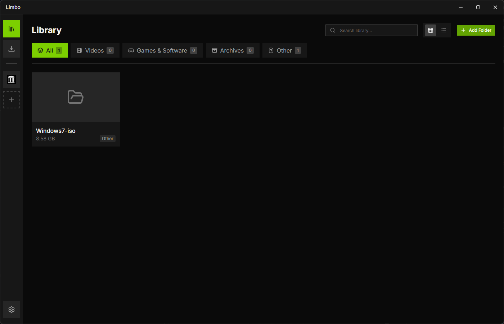

# Limbo

Limbo is a desktop software manager with an integrated browser, download manager, torrent client, Debrid integration, and library view. The UI is React + TypeScript. The desktop host is **Sabine** (Rust).



## What It Does

- Direct HTTP/HTTPS downloads with a queue, resume, and a limit on how many run at once
- Torrent downloads from magnet links and `.torrent` files, with optional seeding
- Real-Debrid, AllDebrid, Premiumize, and TorBox support for supported flows
- Automatic extraction of zip, 7z, and rar archives, including multi-part sets
- Embedded browser with bookmarks, popup blocking, and short-lived session memory
- Local library that collects finished downloads alongside folders you add
- Magnet link and `.torrent` file handling in packaged builds

## Tech Stack

- [Sabine](https://github.com/Lantharos/Sabine) with a shared Chromium runtime
- librqbit for torrents
- Vite + React 19 + TypeScript
- Tailwind CSS
- Base UI / shadcn-style components

## Legal Notice

Limbo is a general-purpose download and organization tool. It supports direct downloads, BitTorrent, Debrid services, and local file management.

Users are solely responsible for ensuring they have the legal right to access, download, and possess any content used with this application. Limbo does not host or provide infringing content.

## Download

Download the latest Limbo release from [GitHub Releases](https://github.com/kaleidal/limbo/releases/latest). Packages are available for Windows and Linux on x86-64 and ARM64, and for Apple silicon Macs.

The public website is [limbo.kaleid.al](https://limbo.kaleid.al). Its download buttons open the latest installer directly. Stable download links are `/download/windows`, `/download/macos`, and `/download/linux`; macOS requires Apple silicon.

Deploy the website with `bun run deploy:marketing`. Download routes resolve the latest published updater manifest, cached for one minute, so new app releases do not require a website deployment.

These initial packages are not yet signed with Apple or Microsoft developer certificates. Windows may show a SmartScreen warning. On macOS, allow Limbo from **System Settings → Privacy & Security** after the first launch attempt. Linux packages do not require an application-signing certificate.

Limbo installs and maintains its shared Sabine Chromium runtime on first launch, so the initial startup requires an internet connection.

## Development

### Prerequisites

- [Bun](https://bun.sh)
- Rust (stable, 1.98+)
- Sabine CLI

Install the matching Sabine tools:

```bash
cargo install --git https://github.com/Lantharos/Sabine --tag v0.61 sabine-cli
```

### Install

```bash
bun install
```

### Run

```bash
bun run dev:desktop
```

This lets Sabine own the Vite process on port 5177, prepares the shared Chromium runtime when needed, regenerates the TypeScript bindings in `src/lib/bindings.ts`, and runs the Rust host from `desktop/`.

The page talks to the Rust host through typed bridge commands. After changing a command, an event, or a type they use, regenerate the bindings:

```bash
sabine bindings .
```

## Build

### Build Renderer

```bash
bun run build
```

### Build Desktop Host

```bash
bun run build:desktop
```

### Bundle Desktop App

```bash
bun run bundle:desktop
```

Pass `--target portable`, `--target appimage`, `--target deb`, `--target rpm`, `--target msi`, `--target exe`, or `--target dmg` directly to `sabine bundle` when you need a specific package format.

## Companion API

Limbo exposes an authenticated localhost HTTP API so companion apps can manage torrents without embedding a torrent client.

The v2 API accepts cross-origin requests from any companion app. Health is public; torrent and event endpoints require the bearer token from Limbo's local discovery file. New torrent requests show an approval prompt by default, with an option to trust the verified executable.

- Health: `GET http://127.0.0.1:17890/v1/health`
- List torrents: `GET /v1/torrents` with `Authorization: Bearer <token>`
- Add torrent: `POST /v1/torrents` with `{ "magnet": "...", "fileIndex": 0, "sequential": true, "clientId": "my-app", "clientName": "My App" }` and `Authorization: Bearer <token>`
- Torrent status: `GET /v1/torrents/:id` with `Authorization: Bearer <token>`
- Stream: `GET /v1/torrents/:id/stream/:fileIndex?token=<token>` with byte-range support
- Remove torrent: `DELETE /v1/torrents/:id?deleteFiles=false` with `Authorization: Bearer <token>`
- Progress events: `GET /v1/events` with `Authorization: Bearer <token>`
- Discovery file under Limbo’s app data directory contains `{ port, token, baseUrl }`

Toggle the API, configure approval prompts, revoke trusted apps, or rotate the access token under Settings → Torrent Settings → Companion API.

### Devices on your network

Turn on **Devices on your network** under Companion API to let other devices, such as Raffi on a TV, stream from Limbo. Limbo then listens on every network interface instead of only `127.0.0.1`, and announces itself over mDNS as `_limbo._tcp`, with its instance ID in the `id` TXT record and the API version in `api`. Allow incoming TCP connections on the API port, and UDP port 5353 for discovery, in your firewall.

A device pairs once with a six-digit code. Choose **Pair** in Limbo's settings to show a code, valid for five minutes and five attempts, and enter it on the device:

- Pair: `POST /v1/pair` with `{ "code": "123456", "deviceName": "Living Room TV" }` returns `{ deviceId, token, instanceId, name }`
- Unpair: `DELETE /v1/pair` with the device's `Authorization: Bearer <token>`

A device token works everywhere the access token does, and torrents a paired device adds skip the approval prompt. Stream URLs in torrent status use the address and token the request came in with, so they work from the device that asked. Remove a device from the list under Companion API to revoke its token.

## Associations

Packaged builds register support for:

- `magnet:` links
- `.torrent` files

## License

This project is licensed under the MIT License. See [LICENSE](./LICENSE).
